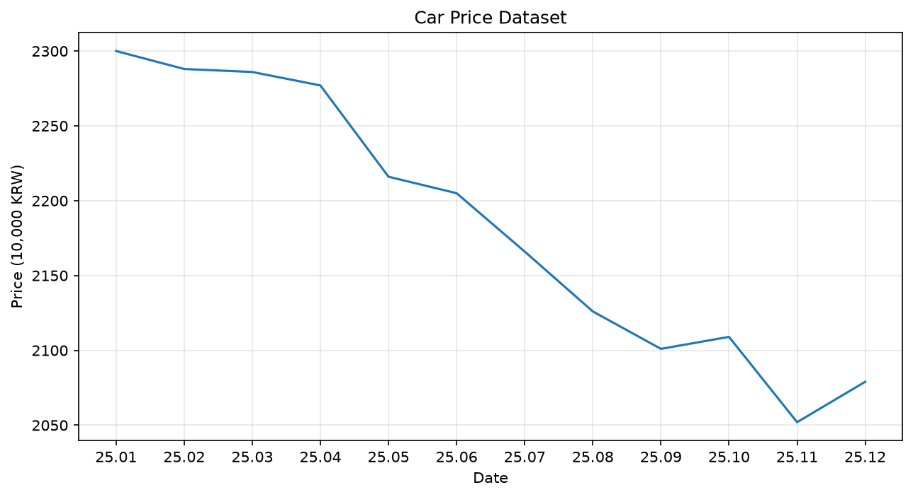

# 1. 문서 개요
> 본 문서는 수학공부를 했던 문서임. 암튼 그럼

# 2. 데이터셋
다음 데이터셋을 사용합니다.

| 차량 가격 (난수) | 이미지 |
| :---: | :---: |
|  |  |
```md
- Source: [scikit-image — Camera](https://scikit-image.org/docs/0.26.x/api/skimage.data.html#skimage.data.camera)
- Author: Lav Varshney
- License: CC0
```