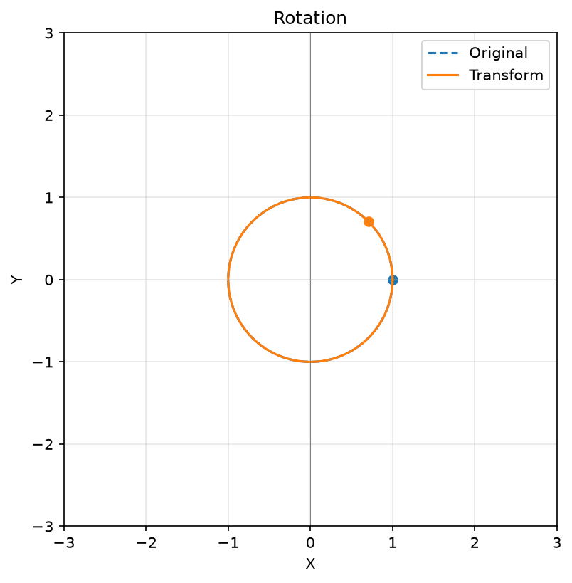
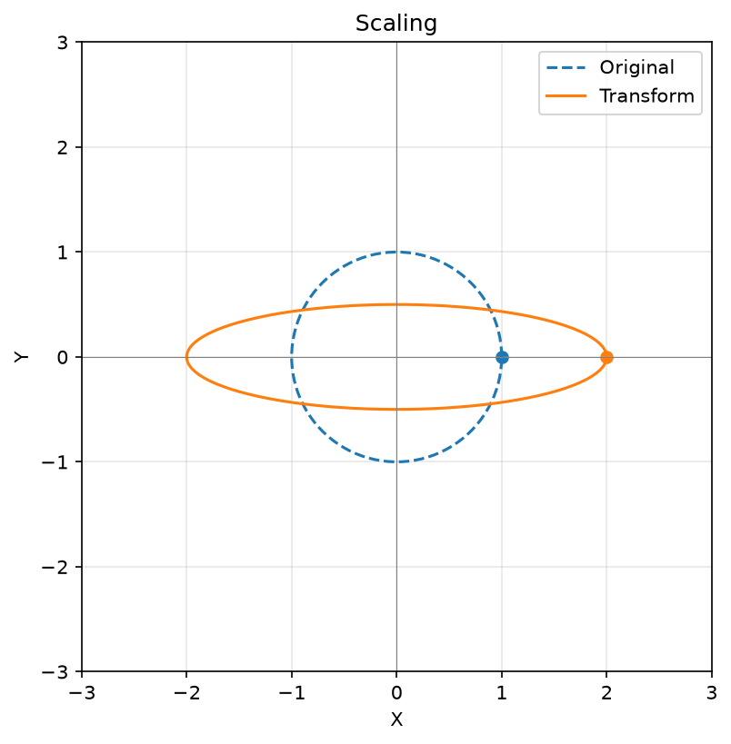
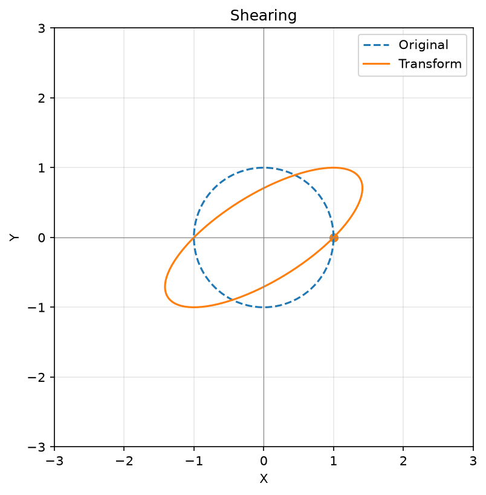

# 1. 문서 개요
> 본 문서는 수학공부를 했던 문서입니다.

# 2. 진행 과정
- 데이터 로드
- 회전, 스케일링, 전단 차트 제작

# 3. 데이터셋
다음 데이터셋을 사용합니다.

| 차량 가격 (난수) | 이미지 |
| :---: | :---: |
|  |  |
```md
- Source: [scikit-image — Camera](https://scikit-image.org/docs/0.26.x/api/skimage.data.html#skimage.data.camera)
- Author: Lav Varshney
- License: CC0
```

# 4. 행렬을 이용한 선형 변환

단위원에 회전, 스케일링, 전단 행렬을 적용한 결과입니다.

| 회전 (45°) | 스케일링 (X축 2배, Y축 0.5배) | 전단 (계수 1) |
| :---: | :---: | :---: |
|  |  |  |
